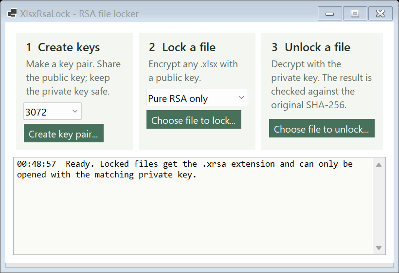

# XlsxRsaLock

A small Windows tool that locks any `.xlsx` file (or any other file) with an RSA public key and unlocks it with the matching private key. After unlocking, the file is **bit-for-bit identical** to the original, so formulas, formats, charts, embedded objects and Unicode text all survive. The tool proves it by checking the SHA-256 of the result against the original before writing it.



## What it does

1. **Create keys.** Generates an RSA key pair (2048, 3072 or 4096 bits) and saves `public_key.pem` and `private_key.pem`. The private key can be protected with a password (PKCS#8, AES-256, 600,000 PBKDF2 iterations). No OpenSSL needed.
2. **Lock a file.** Encrypts a file with the public key into `name.xlsx.xrsa`.
3. **Unlock a file.** Decrypts with the private key, verifies the SHA-256, and restores the original file name.

Two modes:

| mode | how it works | when to use |
|---|---|---|
| **Pure RSA** (default) | The file is split into 190 / 318 / 446-byte slices (2048 / 3072 / 4096-bit keys) and each slice is encrypted directly with RSA-OAEP-SHA256. No symmetric cipher anywhere. | When policy requires public-key encryption end to end. |
| **RSA + AES-256-GCM** | RSA-OAEP wraps a random 256-bit key; AES-GCM encrypts the file and authenticates it. | The standard approach (it is how PGP and TLS work): much faster and smaller output. |

A wrong private key is rejected with a clear message instead of producing garbage, and a damaged or edited file fails the integrity check.

## Tested

`XlsxRsaLock.exe selftest <file>` runs every key size in both modes and compares hashes. On a 143 KB workbook with 3,000 formula rows, a chart, and Japanese, Chinese, Cyrillic, Arabic and Portuguese text:

```
RSA-2048 PureRsa  encrypt     13 ms  decrypt     34 ms  size    193,099  identical: True
RSA-2048 Hybrid   encrypt      1 ms  decrypt      0 ms  size    143,594  identical: True
RSA-3072 PureRsa  encrypt      2 ms  decrypt     64 ms  size    173,259  identical: True
RSA-4096 PureRsa  encrypt      4 ms  decrypt    114 ms  size    164,939  identical: True
RSA-4096 wrong private key rejected: True
ALL CHECKS PASSED
```

A 5 MB file in pure RSA mode unlocks in 1.2 s (2048-bit) to 3.7 s (4096-bit); slices are processed in parallel on all cores.

## Command line

The same exe also works from scripts:

```
XlsxRsaLock keygen  3072 public_key.pem private_key.pem [password]
XlsxRsaLock encrypt report.xlsx public_key.pem report.xlsx.xrsa [pure|hybrid]
XlsxRsaLock decrypt report.xlsx.xrsa private_key.pem report.xlsx [password]
XlsxRsaLock selftest report.xlsx
```

## Build

Requires the .NET 9 SDK on Windows.

```
cd src
dotnet publish -c Release -r win-x64 --self-contained true -p:PublishSingleFile=true -p:EnableCompressionInSingleFile=true -o ../publish
```

The result is a single `XlsxRsaLock.exe` that runs on Windows 10 and 11 without installing anything. Everything it uses ships with .NET, which is free to redistribute.

## File format

```
"XRSA" | version | mode | key bits | SHA-256 of original | key id (8 bytes) | original name | original length | payload
```

The key id is the first 8 bytes of the SHA-256 of the public key, so the tool can tell immediately whether a private key belongs to a file.
